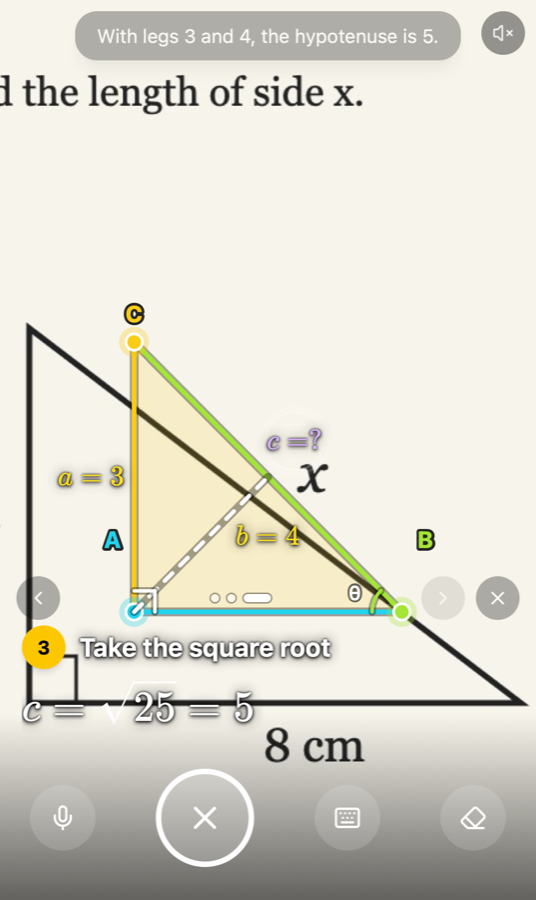
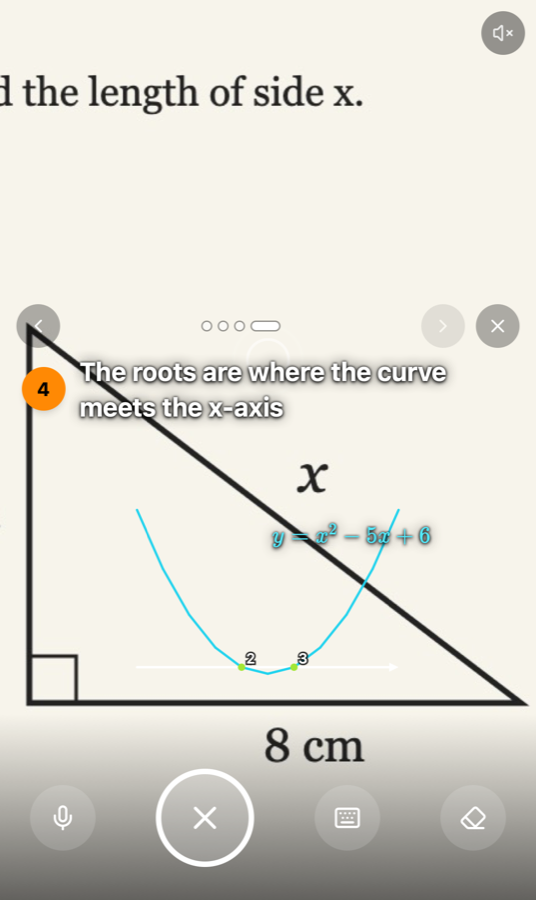

# StepProof

**Point your phone at a math problem and a tutor draws the solution onto it, out loud.**

**Live demo:** [live-vision-ar-canvas.vercel.app](https://live-vision-ar-canvas.vercel.app/). It works best on a phone: allow camera access, point at a math problem and ask.

<p align="center">
  
  &nbsp;&nbsp;
  
</p>

StepProof is a mobile web app that turns the camera into a math tutor. You aim it at a textbook, worksheet or whiteboard and ask a question by voice or by typing. Gemma reads the photo and answers as structured drawing instructions, not a block of text. StepProof then:

- traces the figure in place with a pen
- labels its corners and sides
- works through the solution as numbered steps with real formulas
- has an ElevenLabs voice explain each step as it appears

## Contents

- [Features](#features)
- [How it works](#how-it-works)
- [Quick start](#quick-start)
- [Configuration](#configuration)
- [Trying it without a camera or API keys](#trying-it-without-a-camera-or-api-keys)
- [Project structure](#project-structure)
- [Testing and evaluation](#testing-and-evaluation)
- [Deploying to Vercel](#deploying-to-vercel)
- [Results](#results)
- [Troubleshooting](#troubleshooting)
- [Limitations and roadmap](#limitations-and-roadmap)
- [Tech stack](#tech-stack)
- [License](#license)

## Features

- **Ask your way.** Tap the shutter and type a question, or hold the mic and say it ("find x", "explain this"). An empty question means "solve this step by step".
- **Steady capture.** The shutter keeps the sharpest of a short burst of frames and warns if the photo is blurry or dark.
- **The live camera stays on.** The frame is held only while you type; once you ask, the answer is drawn over the live view. A follow-up question captures a fresh frame.
- **Geometry traced on the page.** A glowing pen draws triangles, circles and lines edge by edge, with:
  - each edge in its own colour and lettered corners (A, B, C)
  - right-angle squares and angle arcs
  - side lengths such as `a = 3` and `c = ?`
- **Step-by-step working.** Formulas are rendered with KaTeX, one numbered step at a time, in a step dock you can page through or swipe. A pulsing ring marks where on the photo the current step applies.
- **Mini whiteboard.** When a picture helps but isn't in the photo (a graph, a construction), the tutor draws it on a small diagram card.
- **A tutor's voice.** An ElevenLabs voice explains each step as it appears ("3 squared is 9, 4 squared is 16, together that makes 25"), with subtitles. The next step waits until the drawing and the sentence are both done.
- **Math only.** Arithmetic, algebra, geometry, trigonometry, statistics and word problems. Conceptual questions ("explain Pythagoras") get a drawn lesson even with nothing relevant in view.
- **Built for phones.** Works in iOS Safari and Android Chrome with no install. It includes:
  - sound cues, and haptics on Android
  - a layout that adapts to landscape
  - support for reduced-motion settings
  - a speaker button to turn the voice off

## How it works

```text
PHONE BROWSER (React)          SERVER (Hono)                  AI SERVICES

Camera capture  ── frame ────► Frame cache
(sharpest of a burst)          (/api/frames, 2 min)
                                     │ frame id
                                     ▼
Ask (voice / text) ─ question ► Answer stream ◄── frame / JSON ──► Gemma
                               (parse, repair, Zod)                (gemma-4-26b-a4b-it)
                                     │
Tutor sequencer ◄───── SSE ──────────┘
(reveal while speaking) ◄── line / audio ──► Speech proxy ◄── text / MP3 ──► ElevenLabs
        │                                    (/api/speech, cached)          (eleven_flash_v2_5)
        ▼ reveal
Overlay renderer
(pen tracing, step dock)
```

1. **Capture.** The browser crops exactly what the viewfinder shows and letterboxes it into a 768×768 frame (WebP or JPEG). It uploads the frame to `POST /api/frames` straight away, while you are still typing or speaking.
2. **Ask.** `POST /api/annotate` sends the question with the frame's id. The server calls Gemma through the Gemini API with a math-tutor system prompt and streams the reply.
3. **Structured answer.** Gemma doesn't write text or code for the screen. It returns JSON in a strict vocabulary of nine element types:

   | Element | Drawn as |
   | --- | --- |
   | `Polygon`, `Circle` | Figures traced on the photo |
   | `Angle` | Arc or right-angle square |
   | `MathLabel` | Formula beside a side |
   | `ConnectorLine`, `TargetBeacon` | Arrows and pins |
   | `Formula`, `InfoCard` | Numbered steps |
   | `Diagram` | Mini whiteboard |

   Every element also carries a spoken `say` line.
4. **Stream, repair, validate.** The server pulls each complete element out of the token stream as it arrives. It repairs LaTeX that broke inside the JSON and converts Gemma's 0–1000 coordinate grid to 0–100. It validates each element with Zod and sends it to the browser as a Server-Sent Event.
5. **Teach.** The browser validates each element again with the same schema. The tutor sequencer then reveals elements one at a time: it draws each one while `/api/speech` speaks its line, and waits for both to finish before moving on.
6. **Render.** A single registry maps each element type to a pre-built React component, so nothing the model writes is ever run as code. A collision-aware layout keeps labels and cards off lines, dots and each other.

API keys stay on the server. Frames are held in memory for two minutes at most and are never written to disk.

## Quick start

**You need** Node.js 22+, [pnpm](https://pnpm.io), a [Gemini API key](https://aistudio.google.com/) for Gemma and, optionally, an [ElevenLabs](https://elevenlabs.io/) key for the voice.

```bash
git clone https://github.com/sajided/live-vision-ar-canvas.git
cd live-vision-ar-canvas
pnpm install
cp .env.example .env      # then add GEMINI_API_KEY (and ELEVENLABS_API_KEY for the voice)
pnpm dev
```

`pnpm dev` starts both parts:

- **Web app:** https://localhost:5173. Vite proxies `/api` to the server, so only this address is needed.
- **API server:** http://localhost:8787.

**On a phone:** connect to the same Wi-Fi and open `https://<your-computer's-LAN-IP>:5173`. The address is printed by `pnpm dev`. Accept the self-signed certificate warning; the camera only works over HTTPS.

| Script | What it does |
| --- | --- |
| `pnpm dev` | Web app + API server with hot reload |
| `pnpm dev:web` / `pnpm dev:server` | Run either half on its own |
| `pnpm build` | Type-check and build the web app into `dist/` |
| `pnpm start` | Run the API server, which also serves `dist/` |
| `pnpm test` | Unit tests (Vitest) |
| `pnpm e2e` | Layout tests in Chromium and WebKit at phone sizes (Playwright) |
| `pnpm typecheck` / `pnpm lint` | TypeScript and oxlint |
| `pnpm gemma:probe <image> [question]` | One live Gemma call, showing the raw output and timings |
| `pnpm gemma:eval <cases.json>` | Benchmark answer correctness, tracing accuracy and latency |

## Configuration

All variables are read by the server only. Never prefix them with `VITE_`, which would ship them to the browser.

| Variable | Default | Purpose |
| --- | --- | --- |
| `GEMINI_API_KEY` | – (required) | Gemini API key used to call Gemma |
| `GEMMA_MODEL` | `gemma-4-26b-a4b-it` | Model id; `gemma-4-31b-it` also works but was slower in our tests |
| `GEMMA_THINKING_LEVEL` | `MINIMAL` | `MINIMAL`, `LOW`, `MEDIUM` or `HIGH`; minimal roughly halves time to first token |
| `GEMMA_JSON_MODE` | `true` | Ask for JSON output (no response schema; Gemma rejects one) |
| `PROMPT_VARIANT` | `full` | `full` or `compact` system prompt |
| `GEMMA_WARMUP` | `true` | One tiny model call when the local server starts, to warm the connection |
| `ELEVENLABS_API_KEY` | – | Tutor voice; without it the browser's built-in voice is used |
| `ELEVENLABS_VOICE_ID` | `JBFqnCBsd6RMkjVDRZzb` | Any voice id from your ElevenLabs account |
| `ELEVENLABS_MODEL` | `eleven_flash_v2_5` | ElevenLabs text-to-speech model |
| `PORT` | `8787` | Local API server port |

`GET /api/health` reports whether the keys are set, for example `{"gemini": true, "tts": true}`.

## Trying it without a camera or API keys

URL parameters make the app easy to explore on a laptop and in tests:

| Parameter | Effect |
| --- | --- |
| `?image=<url>` | Use a still image instead of the camera |
| `?provider=mock` | Use built-in sample answers instead of Gemma (no key needed) |
| `?mock=geometry` | Pick the sample: `geometry`, `algebra`, `steps`, `trace`, `pinpoint`, `invalid` or `random` |
| `?debug` | Show a debug panel: timings, provider switch, validation counts and a **copy metrics** button |

For example: `https://localhost:5173/?provider=mock&mock=geometry&debug`. Then tap the shutter and press send.

## Project structure

```text
api/index.ts            Vercel Function entry (serves server/app.ts)
server/
  app.ts                Hono routes: /api/health, /api/frames, /api/annotate, /api/speech
  index.ts              Local Node server (also serves dist/)
  gemma.ts              Gemini API streaming client
  prompt.ts             Math-tutor system prompt and per-request prompt
  elementStream.ts      Streaming JSON parser that extracts elements as they complete
  annotate.ts           Repair (LaTeX, escapes, grid) + Zod validation + SSE events
  speech.ts             ElevenLabs proxy with an audio cache
  frameCache.ts, rateLimit.ts, upstream.ts
  scripts/              gemma:probe and gemma:eval
src/
  App.tsx               Screen composition and capture → ask → answer flow
  camera/               Camera stream, sharpest-of-burst capture, cover-crop geometry
  ar/                   Schema, parser, layout engine, step dock, overlay renderer
  components/overlay/   One component per element type (Polygon, Formula, Diagram, …)
  components/math/      KaTeX rendering, loaded on demand
  tutor/                Lesson sequencer and narrator (ElevenLabs + browser fallback)
  speech/               Hold-to-talk speech recognition
  mock/                 Sample answers for offline use and tests
e2e/                    Playwright layout tests and fixture image
eval/                   Example eval case file (add your own photos)
docs/                   Benchmarks and screenshots
```

## Testing and evaluation

- **Unit tests** (`pnpm test`, 139 tests) cover:
  - geometry and coordinate mapping
  - the streaming parser, including real Gemma output that broke it
  - LaTeX repair
  - layout and label placement
  - the lesson sequencer
  - rate limiting and caching
- **End-to-end tests** (`pnpm e2e`, 21 tests) run every sample scenario on iPhone 15 (WebKit), Pixel 7 (Chromium) and iPhone landscape. They check that:
  - no cards or labels overlap
  - nothing sits off screen or under the controls
  - formulas never scroll sideways
  - the tutor voice walks through a lesson with subtitles

  These tests use still-image mode and sample answers, so they need no camera or API keys. Install the browsers first with `pnpm exec playwright install chromium webkit`.
- **Gemma eval** (`pnpm gemma:eval eval/cases.json --pause 5000`) runs labelled photos through the real pipeline. It reports schema validity, answer correctness, how far traced corners are from the real figure, and latency at each stage. See `eval/cases.example.json` for the file format; photos go in `eval/images/`, which is git-ignored.

## Deploying to Vercel

The web app is served as static files, and `api/index.ts` runs the same Hono API as a Vercel Function. `vercel.json` sends every `/api/*` request to it, with a 60-second limit.

1. Import the repository in Vercel (framework preset: **Vite**).
2. Under **Settings → Environment Variables**, add `GEMINI_API_KEY`, plus `ELEVENLABS_API_KEY` for the voice, then redeploy.
3. Open `https://<your-app>.vercel.app/api/health`. It should report `"gemini": true` (and `"tts": true` with an ElevenLabs key).

A frame uploaded early can reach a different function instance than the question that follows. When that happens, the browser automatically sends the image again with the question.

## Results

Measured on 9 synthetic math problems (details in [docs/benchmarks.md](docs/benchmarks.md)):

| Measure | Result |
| --- | --- |
| Valid answers | 9/9 |
| Correct final answer | 9/9 |
| Traced-corner error | 0.5% of image width (mean) |
| First token from Gemma (median) | 1.8 s |
| First overlay on screen (median / 95th percentile) | 2.9 s / 8.0 s (target: under 2.5 s) |
| First-load JavaScript (gzipped) | 165 KB, plus 78 KB of KaTeX loaded on demand |

## Troubleshooting

| Problem | Fix |
| --- | --- |
| Camera doesn't start on a phone | Use the `https://` address and accept the certificate. Browsers block the camera on plain HTTP. |
| "The server is missing GEMINI_API_KEY" | Add the key to `.env` (locally) or the Vercel environment variables, then restart or redeploy. |
| The robotic browser voice plays instead of ElevenLabs | Check that `/api/health` shows `"tts": true`, and that the voice id exists in your ElevenLabs account. |
| No sound on iPhone | Tap the screen once (iOS needs a tap before audio), check the silent switch, and check the speaker button isn't muted. |
| Hold-to-talk button missing | The browser doesn't support speech recognition. Use the shutter and type instead. |
| "The tutor is busy" | The Gemini API rate limit was hit. Wait a moment and retry. |

## Limitations and roadmap

**Limitations:**

- Drawings are pinned to the photo that was sent. If you move the phone afterwards, they drift away from the paper.
- The benchmark uses clean synthetic photos; glare, perspective and handwriting are untested.
- The first overlay takes about 2.9 s at the median, just over the 2.5 s target.
- In landscape, a step card can cover part of the photo.

**Next:**

- a real-photo benchmark
- faster first overlay
- feature tracking so drawings stay locked to the paper
- interactive steps where the student answers first
- on-device benchmarks
- more languages

## Tech stack

| Area | Technologies |
| --- | --- |
| AI | Gemma (`gemma-4-26b-a4b-it`) via the Gemini API (`@google/genai`), ElevenLabs text-to-speech |
| Frontend | React 19, TypeScript, Vite, Tailwind CSS 4, Motion, KaTeX, Lucide |
| Browser APIs | getUserMedia, Web Speech API, WebAudio, Vibration, Canvas, visualViewport |
| Backend | Node.js, Hono, Server-Sent Events, Vercel Functions |
| Validation | Zod (one schema shared by server and client) |
| Testing | Vitest, Playwright, custom Gemma eval harness |

## License

[MIT](LICENSE)
